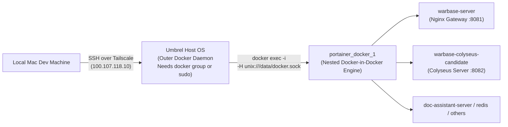

# Umbrel & Portainer Container Access Guide

> **Audience:** Developers and AI assistants working on the WarBase deployment infrastructure.  
> **Purpose:** Detailed operational reference explaining how to connect, inspect, build, and deploy containers running inside the Portainer environment on the Umbrel host server.

---

## Current release note — 5 November 2026

The nested Docker method below is correct and Docker access has been restored for the `umbrel` SSH account. It requires permission to access the outer Docker socket before `docker exec` can enter the nested engine.

For the current Colyseus release, use [the paired admission/gateway runbook](warbase-colyseus/deploy/ADMISSION.md). The generic recreate example in section 3.3 is historical: `warbase-server` now runs Nginx, and combat runs in `warbase-colyseus-candidate`. Preserve admin volumes, private port bindings and rollback containers. The signed-admission gateway uses host networking and requires the freshly verified `WARBASE_TUNNEL_TRUST_CIDR`; the connector's address changed to `10.21.0.11` after the restart. Inspect it before each release.

## 1. Quick Summary (TL;DR)

**Question:** *Are we accessing the Portainer containers via SSH?*  
**Answer:** **Yes, absolutely.** However, there are two crucial operational details that trip up other developers and AI assistants:

1. **Docker Group Permissions on the Umbrel Host:**  
   The outer command `docker exec portainer_docker_1 ...` talks to the host socket `/var/run/docker.sock`. If the SSH user `umbrel` is not in the host's `docker` group, it fails immediately with:
   `permission denied while trying to connect to the Docker daemon socket at unix:///var/run/docker.sock`  
   *See Section 3.0 below for the 1-minute command to fix this.*

2. **The Docker-in-Docker (DinD) Hierarchy:**  
   Portainer on Umbrel does NOT run containers directly on the host. It runs a nested Docker daemon inside `portainer_docker_1`. All game containers live inside that nested engine on socket `unix:///data/docker.sock`.



---

## 2. Infrastructure Architecture & Topology

### 2.1 Network & Addressing

| Component | Identifier / IP | Notes |
| :--- | :--- | :--- |
| **Server Hostname** | `umbrel` | Resolved automatically via Tailscale MagicDNS |
| **Tailscale IPv4** | `100.107.118.10` | Static VPN IP assigned to the Umbrel server |
| **SSH User** | `umbrel` | Default user with sudo and docker group privileges |
| **SSH Port** | `22` | Standard SSH daemon |
| **Public Domain** | `https://war.vaidik.blog/` | Cloudflare Tunnel routing to `umbrel.local:8081` |
| **Private Admin Dashboard** | `http://100.107.118.10:8082/admin/` | Colyseus Admin Panel (Tailscale-only) |
| **Private Monitor** | `http://100.107.118.10:8082/monitor/` | Colyseus Live Monitor (Tailscale-only) |

### 2.2 The Two Docker Engines: Outer vs. Inner (DinD)

| Property | Outer Engine (Umbrel Host) | Inner Engine (Portainer DinD) |
| :--- | :--- | :--- |
| **Running Process** | System `dockerd` on Linux | Container `portainer_docker_1` (`docker:27.2.0-dind`) |
| **Socket Location** | `/var/run/docker.sock` | `unix:///data/docker.sock` (inside `portainer_docker_1`) |
| **Host Volume Mount** | Native filesystem | `/home/umbrel/umbrel/app-data/portainer/data/docker` &rarr; `/data` |
| **Visible Containers** | `portainer_docker_1`, `portainer_portainer_1`, `cloudflared_connector_1`, `plex_server_1`, etc. | `warbase-server`, `warbase-colyseus-candidate`, `doc-assistant-server`, `greenlight-api`, etc. |
| **Docker Network** | `host`, `bridge`, `umbrel_default` | `warbase_server_default`, `bridge` |

> [!WARNING]
> **Common AI Pitfall:** If an AI assistant executes `ssh umbrel "docker ps"` and looks for `warbase-server`, it will report that the container does not exist or has vanished. The container is running healthy inside the nested DinD daemon!

---

## 3. Step-by-Step Operations Manual

### 3.0 Resolving "Permission Denied on /var/run/docker.sock" (CRITICAL FIX)

When an AI assistant or developer runs `ssh umbrel "docker exec portainer_docker_1 ..."` and sees:
```
permission denied while trying to connect to the Docker daemon socket at unix:///var/run/docker.sock
```
This means the outer Linux host account `umbrel` is **not currently in the host's `docker` group**, or non-interactive `sudo` is required.

#### Option A: Grant Non-Root Docker Access (Recommended — 1-Minute Fix)
Run this single command from your local terminal to add the `umbrel` user to the `docker` group on the host:

```bash
ssh -t umbrel "sudo usermod -aG docker \$USER && sudo systemctl restart docker"
```
*(Enter the server password when prompted).*

To ensure the new group is active without restarting the entire machine, either log out and log back in, or test immediately:
```bash
ssh umbrel "docker ps"
```
If `docker ps` outputs the running containers without errors, the permission issue is completely resolved!

#### Option B: Configure Passwordless Sudo for Docker on Umbrel Host
If you prefer not to alter group permissions, allow the `umbrel` user to run `docker` with `sudo` without entering a password:
```bash
ssh -t umbrel 'echo "umbrel ALL=(ALL) NOPASSWD: /usr/bin/docker" | sudo tee /etc/sudoers.d/umbrel-docker'
```
Then, AI assistants can simply prefix outer commands with `sudo`:
```bash
ssh umbrel "sudo docker exec portainer_docker_1 docker -H unix:///data/docker.sock <COMMAND>"
```

---

### 3.1 Step 1: Ensure Tailscale Connectivity

The Umbrel server is only reachable over Tailscale. If SSH fails with `Operation timed out` or `Could not resolve hostname`, verify Tailscale on your local machine:

```bash
# Check Tailscale status
/Applications/Tailscale.app/Contents/MacOS/Tailscale status

# If stopped or disconnected, bring Tailscale up:
/Applications/Tailscale.app/Contents/MacOS/Tailscale up

# Test SSH connection:
ssh -o ConnectTimeout=5 umbrel "echo connected"
# Or using the direct Tailscale IP:
ssh -o ConnectTimeout=5 umbrel@100.107.118.10 "echo connected"
```

---

### 3.2 Basic Container Management Commands

All commands follow the nested invocation format:

#### 1. List All Running Containers
```bash
ssh umbrel "docker exec portainer_docker_1 docker -H unix:///data/docker.sock ps"
```

#### 2. List All Containers (Including Stopped)
```bash
ssh umbrel "docker exec portainer_docker_1 docker -H unix:///data/docker.sock ps -a"
```

#### 3. View Live Container Logs
```bash
# View last 50 lines:
ssh umbrel "docker exec portainer_docker_1 docker -H unix:///data/docker.sock logs --tail 50 warbase-server"

# Follow logs in realtime:
ssh umbrel "docker exec portainer_docker_1 docker -H unix:///data/docker.sock logs -f warbase-colyseus-candidate"
```

#### 4. Inspect Container Configuration & Environment
```bash
ssh umbrel "docker exec portainer_docker_1 docker -H unix:///data/docker.sock inspect warbase-server"
```

#### 5. Restart, Stop, or Start a Container
```bash
# Restart container:
ssh umbrel "docker exec portainer_docker_1 docker -H unix:///data/docker.sock restart warbase-server"

# Stop container:
ssh umbrel "docker exec portainer_docker_1 docker -H unix:///data/docker.sock stop warbase-server"

# Start container:
ssh umbrel "docker exec portainer_docker_1 docker -H unix:///data/docker.sock start warbase-server"
```

#### 6. Execute an Interactive Shell Inside a Container
```bash
ssh -t umbrel "docker exec -it portainer_docker_1 docker -H unix:///data/docker.sock exec -it warbase-server sh"
```

---

### 3.3 Building & Deploying Docker Images

Because the nested DinD engine has its own isolated image store, images built on the Umbrel host are **not** automatically visible inside Portainer DinD. There are two approved ways to deploy new images:

#### Method A: Build on Umbrel Host & Load into DinD (Recommended for Large Builds)

This method builds with the host's full resources, then streams the image archive into DinD:

```bash
# 1. Transfer source code from local Mac to Umbrel host:
tar -C /tmp/deploy-pkg -czf - . | ssh umbrel "rm -rf /home/umbrel/warbase-deploy && mkdir -p /home/umbrel/warbase-deploy && tar -xzf - -C /home/umbrel/warbase-deploy"

# 2. Build the Docker image on the Umbrel host:
ssh umbrel "docker build -t warbase_server-warbase-server:latest /home/umbrel/warbase-deploy"

# 3. Stream/Pipe the image into the Portainer DinD engine:
ssh umbrel "docker save warbase_server-warbase-server:latest | docker exec -i portainer_docker_1 docker -H unix:///data/docker.sock load"

# 4. Recreate the container inside DinD:
ssh umbrel "docker exec portainer_docker_1 docker -H unix:///data/docker.sock stop warbase-server && \
docker exec portainer_docker_1 docker -H unix:///data/docker.sock rm warbase-server && \
docker exec portainer_docker_1 docker -H unix:///data/docker.sock run -d \
  --name warbase-server \
  --restart unless-stopped \
  --network warbase_server_default \
  -p 8081:8081 \
  -e ENV=production \
  --label com.docker.compose.project=warbase_server \
  --label com.docker.compose.service=warbase-server \
  --label com.docker.compose.version=2.29.2 \
  warbase_server-warbase-server:latest"
```

#### Method B: Stream Build Context Directly into DinD via Stdin

For smaller builds or headless harnesses (as seen in `scripts/run_colyseus_official_load_nested.sh`), pipe a tar stream directly into DinD's `docker build -`:

```bash
tar -cf - .dockerignore warbase-colyseus/Dockerfile.candidate ... | \
  ssh umbrel "docker exec -i portainer_docker_1 docker -H unix:///data/docker.sock build -t warbase-colyseus:candidate -"
```

---

### 3.4 Managing Docker Compose Stacks Inside DinD

Portainer organizes projects using Docker Compose. If you need to run Docker Compose commands against the nested stack:

```bash
# Check stack status:
ssh umbrel "docker exec -i portainer_docker_1 docker -H unix:///data/docker.sock compose -p warbase_server ps"

# Restart an entire Compose stack:
ssh umbrel "docker exec -i portainer_docker_1 docker -H unix:///data/docker.sock compose -p warbase_server restart"
```

---

### 3.5 Verifying Public Routing & Cloudflare Tunnel

Public traffic flows: `User` &rarr; `Cloudflare Edge` &rarr; `cloudflared_connector_1` (on Umbrel host) &rarr; `umbrel.local:8081` &rarr; `warbase-server` (Gateway in DinD).

#### Check Service Health
```bash
# 1. Check local listener on Umbrel host:
ssh umbrel "curl -i http://localhost:8081/healthcheck"

# 2. Check public HTTPS endpoint:
curl -i https://war.vaidik.blog/healthcheck

# 3. Check live multiplayer rooms:
curl -s https://war.vaidik.blog/api/rooms | jq .
```

#### Restart Cloudflare Connector if 530 Error Occurs
If `curl https://war.vaidik.blog/` returns HTTP 530 (Cloudflare Error 1033 - Tunnel offline), restart the connector container on the Umbrel host:
```bash
ssh umbrel "docker restart cloudflared_connector_1"
```

---

### 3.6 Direct Access via Portainer Web UI & REST API

If SSH access to Docker is temporarily blocked and you do not have sudo privileges:

#### 1. Portainer Web UI
- **URL (Tailscale):** [http://100.107.118.10:9000](http://100.107.118.10:9000) or [https://100.107.118.10:9443](https://100.107.118.10:9443)
- **URL (LAN):** `http://umbrel.local:9000`
- **Dashboard Navigation:**
  1. Log in with the Portainer administrator credentials created during Umbrel setup.
  2. Click on the **local** environment.
  3. Go to **Containers** to see `warbase-server`, `warbase-colyseus-candidate`, `doc-assistant-server`, etc.
  4. From the UI, you can directly:
     - Start / Stop / Restart containers.
     - View live container logs.
     - Open an interactive terminal (`Exec Console`).
     - Recreate or edit container settings.
     - Deploy or update Stacks (Docker Compose).

#### 2. Portainer REST API (Programmatic AI Access)
Portainer exposes a REST API on port 9000/9443. An AI assistant can use the API if given an API Access Token:
1. In Portainer UI &rarr; Click user icon in top-right &rarr; **My account**.
2. Scroll to **Access tokens** &rarr; Click **Add access token** (e.g. description "ai-deploy").
3. Use the token in HTTP requests:
```bash
# Test API connectivity:
curl -k -H "X-API-Key: ptr_YOUR_TOKEN" https://100.107.118.10:9443/api/endpoints

# List containers in endpoint 2 (the local DinD engine):
curl -k -H "X-API-Key: ptr_YOUR_TOKEN" https://100.107.118.10:9443/api/endpoints/2/docker/containers/json

# Restart warbase-server container via API:
curl -k -X POST -H "X-API-Key: ptr_YOUR_TOKEN" https://100.107.118.10:9443/api/endpoints/2/docker/containers/warbase-server/restart
```

---

## 4. Helper Script & Shell Aliases

To make interacting with Portainer DinD as effortless as regular Docker, you can define a shell function or script.

### 4.1 Shell Function (Add to `~/.zshrc` or `~/.bashrc`)

```bash
# Direct CLI to Portainer DinD on Umbrel
p-docker() {
  ssh -t umbrel "docker exec -it portainer_docker_1 docker -H unix:///data/docker.sock $*"
}

# Non-interactive CLI (for scripts and pipes)
p-docker-run() {
  ssh umbrel "docker exec -i portainer_docker_1 docker -H unix:///data/docker.sock $*"
}
```

**Usage Examples:**
```bash
p-docker ps
p-docker logs -f warbase-server
p-docker exec -it warbase-server sh
p-docker restart warbase-server
```

---

## 5. Copy-Paste Instructions for Other AI Assistants

When handing off deployment or maintenance tasks to another AI assistant (e.g. Claude, ChatGPT, Cursor, or another Antigravity instance), provide them with the prompt below.

```markdown
### SYSTEM INSTRUCTION: HOW TO ACCESS DOCKER CONTAINERS ON UMBREL / PORTAINER

You are managing containers on a remote Linux server running Umbrel OS.
Server connection details:
- SSH Host: `umbrel` (or Tailscale IP `100.107.118.10`)
- SSH User: `umbrel`
- Network: Accessible only when Tailscale VPN is running locally on the client machine.

CRITICAL ARCHITECTURAL RULES & RESOLUTION:

1. DOCKER GROUP PERMISSION ERROR:
If running `docker` gives: "permission denied while trying to connect to the Docker daemon socket at unix:///var/run/docker.sock":
   a) The user needs docker group membership. Fix with: `ssh -t umbrel "sudo usermod -aG docker \$USER"` (user enters password once).
   b) Or run with sudo if passwordless sudo is configured: `ssh umbrel "sudo docker exec portainer_docker_1 ..."`

2. NESTED DOCKER DAEMON (DinD):
Do NOT expect game containers to show up in regular host `docker ps`.
The Umbrel host runs Portainer as Docker-in-Docker (DinD):
- Host container running DinD: `portainer_docker_1`
- DinD Unix socket: `unix:///data/docker.sock`
- All game containers (`warbase-server`, `warbase-colyseus-candidate`, `doc-assistant-server`, etc.) live INSIDE `portainer_docker_1`.

HOW TO EXECUTE COMMANDS:
Always wrap Docker commands through the DinD container:
`ssh umbrel "docker exec portainer_docker_1 docker -H unix:///data/docker.sock <COMMAND>"`
(Or with sudo if user is not in docker group: `ssh umbrel "sudo docker exec portainer_docker_1 docker -H unix:///data/docker.sock <COMMAND>"`)

Examples:
- List containers:
  `ssh umbrel "docker exec portainer_docker_1 docker -H unix:///data/docker.sock ps"`
- Inspect logs:
  `ssh umbrel "docker exec portainer_docker_1 docker -H unix:///data/docker.sock logs --tail 50 <container_name>"`
- Restart a container:
  `ssh umbrel "docker exec portainer_docker_1 docker -H unix:///data/docker.sock restart <container_name>"`
- Load a newly built image into DinD:
  `ssh umbrel "docker save <image_name>:latest | docker exec -i portainer_docker_1 docker -H unix:///data/docker.sock load"`

ALTERNATIVE - PORTAINER REST API:
If host Docker socket access is unavailable, Portainer has a REST API on port 9443:
- URL: `https://100.107.118.10:9443/api/endpoints/2/docker/...`
- Auth: Header `X-API-Key: <token>`
```

---

## 6. Historical Reference & Related Repository Files

- [warbase-colyseus/deploy/LEGACY_RETIREMENT.md](file:///Users/vaidik/Developer/WarBase%20/warbase-colyseus/deploy/LEGACY_RETIREMENT.md): Documents the active gateway deployment, Nginx routing, and retirement of the legacy Go service.
- [warbase-colyseus/deploy/README-candidate.md](file:///Users/vaidik/Developer/WarBase%20/warbase-colyseus/deploy/README-candidate.md): Details the Colyseus candidate deployment and container specs.
- [scripts/run_colyseus_official_load_nested.sh](file:///Users/vaidik/Developer/WarBase%20/scripts/run_colyseus_official_load_nested.sh): Production bash script demonstrating nested DinD build context streaming, image tagging, and execution wrappers.
