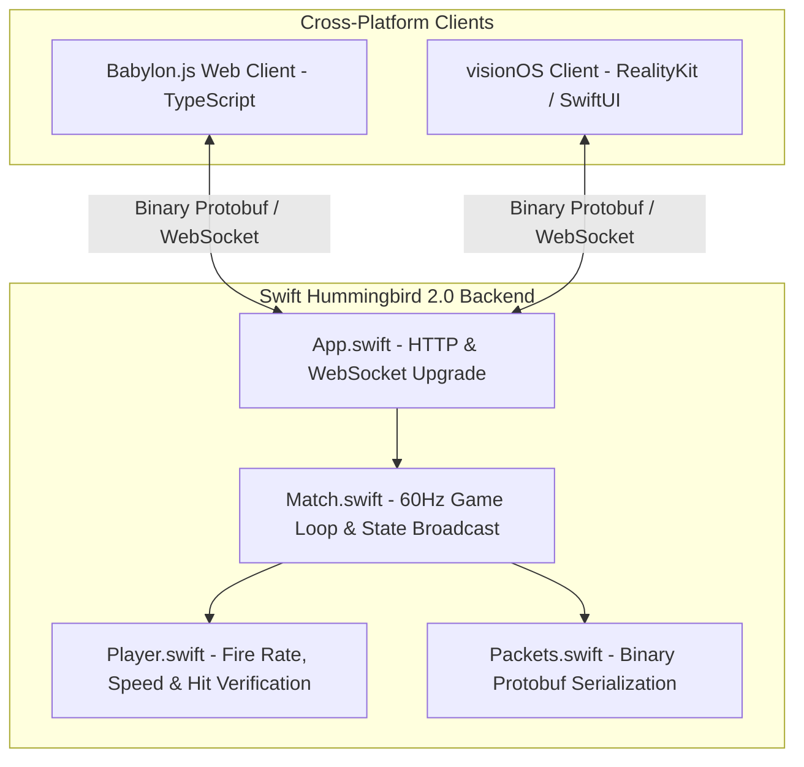

# Warbase Battle Royale

A high-performance, real-time multiplayer FPS game with unified cross-platform clients (Web Babylon.js + visionOS RealityKit) powered by a high-throughput **Swift 6 + Hummingbird 2.0** server.

---

## System Architecture

The game utilizes an **authoritative server architecture** streaming 60Hz binary Protocol Buffer messages over WebSockets with client-side prediction and server-side anti-cheat validation.



---

## Directory Structure

```
WarBase/
├── client/           # Babylon.js Web Client (TypeScript, Vite, Havok Physics)
├── WarBaseClient/    # Native Apple visionOS Client (RealityKit, SwiftUI)
├── server-swift/     # Authoritative Game Server (Swift 6, Hummingbird 2.0, Swift-NIO)
├── shared/           # Canonical Protocol Buffer definitions (packets.proto)
├── context mds/      # Game mechanics, networking, and anti-cheat documentation
├── docker-compose.yml# Production Docker deployment stack
└── Makefile          # Unified build and run commands
```

---

## Getting Started

### 1. Run the Unified Game Server Locally
Builds the web client and starts the Swift game server on port `8081`:
```bash
make run
```
Open your browser at `http://localhost:8081` to play!

### 2. Run Optimized Release Server
Compiles with Swift release optimizations (`-c release`):
```bash
make run-release
```

### 3. Run Web Client Dev Server
For rapid frontend iteration with hot module reloading:
```bash
make dev-client
```

### 4. Deploy with Docker
```bash
make docker
# Or via Docker Compose:
docker compose up -d --build
```

