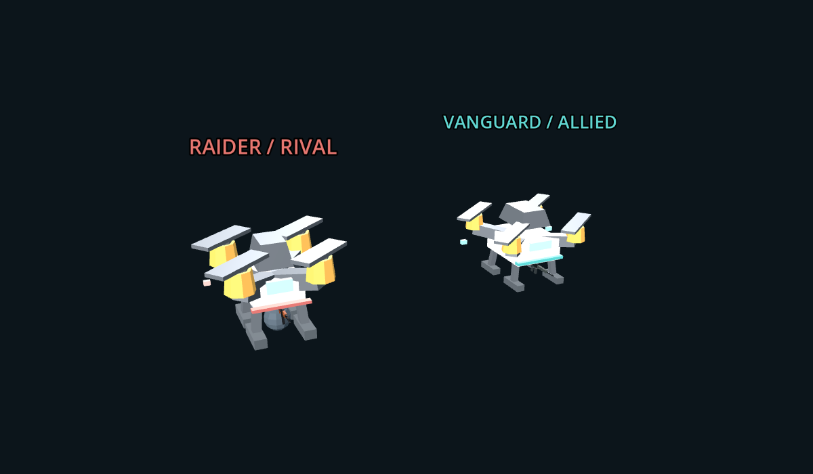

# Drone Conquest — 2026-11-07

Updated November 11, 2026. The protocol 13 native and Web builds and the revised bot server passed local verification. Umbrel verification and promotion require the Mac to reconnect to Tailscale. The public health endpoint still reported protocol 12.

## Gameplay

Free flight replaces walking and jumping. WASD moves horizontally, Space ascends, Ctrl/C descends, Shift boosts. Release controls to brake and hover. Horizontal speed is 8 m/s (boost 14), vertical speed 6 m/s (boost 9), ceiling 120 m. Spawn centers are 0.9 m above authored ground. Conquest A–D and M tactical map remain; capture requires proximity within 6 m vertically. Cars remain parked collision obstacles and cannot be entered by drones. Audio remains disabled.

Allied/local Vanguard and rival Raider use distinct animated CC0 airframes. Both fit the same 0.4 m collision/hit sphere; cosmetic differences confer no hitbox advantage. Mounted weapon modules replace floating first-person rifles; hull sparks replace blood. Sniper damage remains one shot on a valid hit. Payload gimbals follow aim independently of hull bank; network pitch converts explicitly between Godot and server conventions. Rotor animation and bank are cosmetic; server position and damage remain authoritative.

## Models

- [Quadcopter Camera](https://3dassets.dev/assets/robots-and-drones-kit-quadcopter-camera-16e693ab): Vanguard, 508 triangles.
- [Quadcopter Inspection](https://3dassets.dev/assets/robots-and-drones-kit-quadcopter-inspection-bd37c477): Raider, 652 triangles.

Original GLBs are archived under `asset_backups/drone_sources/`. `assets/drones/SOURCES.json` records source, CC0 license, original hashes and conversion. Godot 4.7.2 rejected KHR_mesh_quantization; glTF Transform 4.5.1 dequantized the vertex attributes while preserving geometry, materials and rotor animation. Runtime GLBs total about 73 KB. Retired humanoid model/pose data are excluded from both client packages; unused blood and casing pools are not allocated. No additional runtime library is required.

## Reliability

Colyseus official buffered inputs, Predict.sim/reconciliation and render interpolation remain in use. Shared TS/GDScript flight math supplies the game-specific movement rules. Static-map BVH sweeps and parked vehicle geometry constrain the common sphere; there is no gravity or floor snapping. Velocity quantization preserves submillimetre braking so a tiny residual velocity cannot persist forever. SDK-owned render branches disable duplicate Godot physics interpolation, following [Godot interpolation guidance](https://docs.godotengine.org/en/stable/tutorials/physics/interpolation/advanced_physics_interpolation.html).

Vehicle reverse steering, rotated-corner sweeps, safe wall sliding and bounded cosmetic impact response remain in the source for future driving modes. This is not a full rigid-body vehicle simulation. Floating player beacons were removed.

## Verification

- Server suite: 130 passed, 1 optional benchmark skipped, 0 failed.
- Native/server flight parity: 792 checkpoints, all 11 maps and 132 starts; maximum position error 1.417 mm and velocity error 0.000197 m/s.
- Independent native collision audit: 1,584 sphere-overlap queries; zero overlaps, speed or ceiling violations.
- Drone visual and payload tests pass; all seven modules fit the shared body envelope.
- Complete offline game-flow and retained Godot regression suite passed, including FPV near-plane clearance and all seven payload visibility masks. Native and Web exports passed with the same source fingerprint `2e55306049931012112ad8b8d12b8e208fbd3867c96918879e1cc03815322a54`. Native ZIP: 182,978,038 bytes, about 4.1 MB below the preceding release. Web PCK: 214 resources, with all 11 maps covered by the main/optional packages.

- Resoforge bot navigation now checks for floor support below drone height, searches the nearest navigation links first and caps collision sweeps per lookup. A bot accelerating from rest keeps its route instead of immediately planning again.
- The local Resoforge replay recorded 0.28 ms at the 95th percentile for seven bot updates per tick. Six bots traveled more than half a metre from their spawns. The new spawn movement regression passed.
- A local SDK probe joined all 11 Conquest maps with eight clients per room and measured zero drift after braking. A separate Resoforge run joined with seven active bots and completed the same flight checks. All six optional Web map packs served through the local HTTP listener. The temporary listener was shut down.

After restoring Tailscale access, inspect the previous Umbrel staging state, rebuild with the revised bot code, and repeat the staged Resoforge bot check before promoting protocol 13. Use per-map batches for the eight-client probe so staging retains its normal admission limits.

