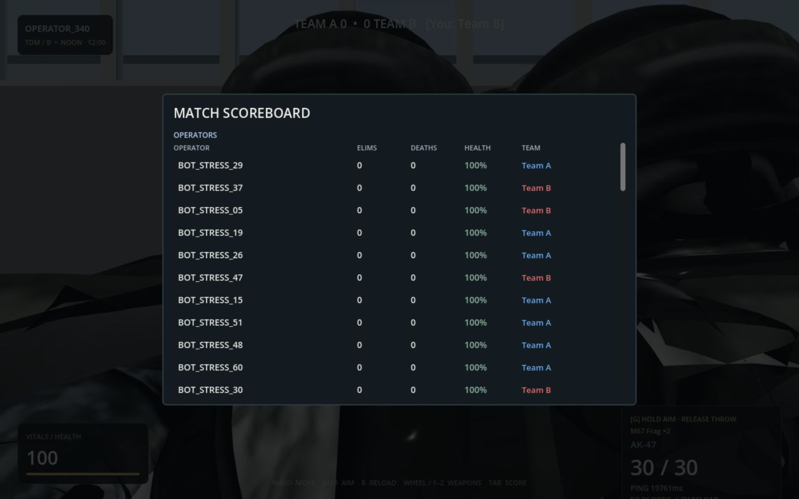
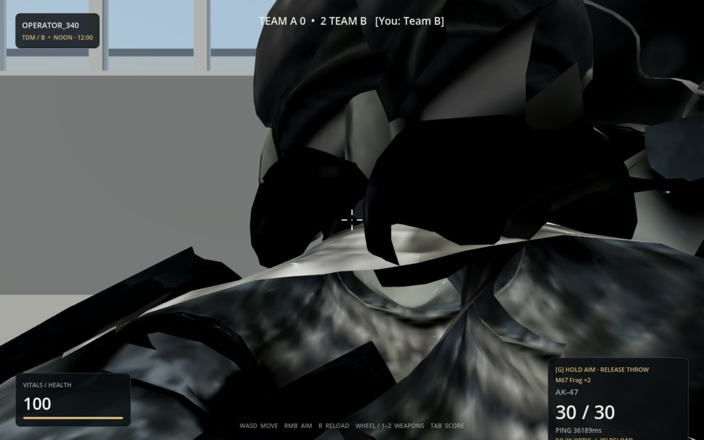

# Official-server capacity and gameplay diagnosis — 27 October 2026

**Result: FAIL for sustained 64-player readiness on the tested end-to-end connection path.**

All live game traffic used **war.vaidik.blog**, with encrypted WebSockets through the official domain. No localhost server was used. Tests ran in dedicated QA rooms on the production server. The advertised room capacity is 64. Independent `/api/rooms` samples confirmed 64/64, and both a rendered native client and the deployed Web client received populated match snapshots. Protocol peers generated the remaining player load; these were not 64 rendered clients or 64 independent physical machines.

## What ran

- Industrial Zone: 62 protocol peers plus native and Web observers. The corrected traffic run lasted 150 seconds. Its earlier occupancy-only phase did not spawn protocol players correctly and is excluded from the load-generator results. The native observer's 190-second aggregate includes that early phase, ramp, driving, and the subsequent full entity load; its percentile figures are not a uniform 190 seconds at exactly 64 players.
- Native actual gameplay: authoritative car entry, approximately 80.2 m of observed car travel over 37 seconds, exit to infantry, movement, and replicated combat effects. The observer saw up to 63 remote combatants and no locally simulated bots.
- Single-peer official-server baseline: 20 seconds.
- Desert Oasis: 63 protocol peers, movement only, no fire or grenades, 180 seconds. This isolates the problem from combat effects; that run did not independently establish a healthy 64th player throughout.
- Fresh Industrial Zone Web verification: 63 protocol peers plus the deployed Web client, 65 seconds. Independent occupancy polling confirmed 64/64. The game displayed remote players, the scoreboard, and increasing ping. This fresh run had no load-generator connection errors before its scheduled stop, but authority occupancy fell before all local socket readers ended.

## Measurements

| Measurement | One-peer baseline | Industrial combat load | Desert movement-only load | Fresh Web match load |
| --- | ---: | ---: | ---: | ---: |
| Load peers joined | 1 | 62 | 63 | 63 |
| Ping median | 343 ms | 61,935 ms | 68,887 ms | 29,203 ms |
| Ping p95 | 369 ms | 106,101 ms | 105,401 ms | 47,455 ms |
| Snapshot gap p95 | 42.1 ms | 267.9 ms | 229.2 ms | 341.3 ms |
| Snapshot gap maximum | 287 ms | 1,294 ms | 1,432 ms | 1,185 ms |
| Unexpected peer connection endings | 0 | 13 | 63 | 0 before scheduled stop |

These ping measurements use echoed client timestamps. They include delayed delivery of old messages; they are evidence of a backlog, not estimates of geographic propagation latency. Socket count is a local transport observation, not proof that the authority still counts the player as connected. Movement-only clients ultimately received abnormal WebSocket closure code 1006 / unexpected EOF.

Native aggregate: median frame time 8.33 ms, p95 24.71 ms, p99 48.48 ms, maximum 149.02 ms. Its own snapshot gaps reached 2,244 ms. Position disagreement reached 6.32 m, with 345 observed snapshots above the client's 2.5 m correction threshold. These are disagreements, not a count of 345 actual teleports, and include normal latency as well as rejection/correction. The native ping p95 was 46.6 seconds. See `native-industrial.json` and the per-second log for phase context.

The Web HUD visibly reached approximately **24 seconds of ping** during the fresh full-room run. Nearby remote body/weapon meshes obscured the camera. Screenshots are attached below.

## Diagnosis and priorities

1. **Critical: stale traffic/backlog under full connection load.** Movement-only load also reproduced it. The API could report no remaining QA players while connected local readers continued receiving old data. The health endpoint stayed available; that coarse health check does not establish playable latency. Repeated full-capacity tests failed even though the low-load baseline was much more stable.
2. **High: visible correction and crowded-spawn behaviour.** The native client disagreed with authority by metres. The Web camera was obscured by nearby remote player geometry. Delayed snapshots, hard reconciliation, initial spawn overlap, and presentation of very close remote models need separate fixes/verification. The current protocol carries no server snapshot timestamp or sequence for determining the age of an authoritative position.
3. **High: connection recovery is unclear.** The Web client could remain on a level without responsive gameplay after a test room disappeared. The source uses transient HUD messages for connection errors; there is no clear persistent stale-state/synchronization timeout flow. Users should get an explicit reconnecting state and a reliable route back to the room list.
4. **Secondary: frame-time spikes.** Rendering is not uniformly smooth under the tested entity/effect load, despite many native samples reporting 110–120 FPS. Network delay is nevertheless much larger than the observed frame spikes and cannot be fixed by changing textures or shadows.

**The exact limiting component is not proven.** Server CPU, event queues, per-connection pending writes, Cloudflare/tunnel buffering, and the load generator's shared network path were not independently instrumented. All simulated peers originated from one machine/network. These tests establish failure of this connection path under this workload, not a distributed global capacity rating or proof of a particular backend CPU bottleneck.

Next work should collect authenticated server tick-duration/queue/write-age metrics without publicly exposing a profiler; repeat smaller stepped loads and a distributed load; bound pending input/output age; coalesce replaceable movement/vehicle input; add authoritative snapshot timestamps and latency-aware reconciliation; and improve occupied-spawn selection and connection recovery. Retest the deployed native/Web pair after those changes. Reducing packet frequency or moving transport is a hypothesis to evaluate against the measured bottleneck, not a verified fix from this run.

## Web verification limits

The in-app Chromium browser rendered and joined the real official matches, but rejected pointer lock (`WrongDocumentError`). Consequently Web aiming, manual car entry/driving, and a reliable Web frame-time distribution are **not certified** by this run. Safari remained at a connecting lobby and Edge remained in a cold-load progress screen during their checks; neither produced a usable controlled gameplay run. These observations are recorded as test limitations, not conclusive product-browser incompatibility findings. Native driving and protocol-level authoritative vehicle movement were verified separately. A fresh full desktop browser driving check remains required.

## Changes made and cleanup

The stress generator now supports official-domain WSS, bounded 1–64 peer runs, correct initial authority spawn, real vehicle seats/inputs, combat-off controls, socket close logs, and JSON timing reports. A native rendered observer and usage documentation were added. The generator builds with race instrumentation; `go vet ./cmd/stress` passes. That package has no unit tests. No production game/server release was deployed or restarted for this audit. All bounded generators and the native observer exited; the Web QA client was closed. The official health endpoint reported `available` after the tests.

## Evidence

- [Native aggregate](native-industrial.json), [native log](native-industrial.log)
- [Industrial load](industrial-load.json), [baseline](baseline-load.json)
- [Movement-only load](movement-only-load.json)
- [Fresh Web load](web-final-load.json), [independent occupancy](web-final-occupancy.json)
- [Browser console](web-console.json), [final health](final-health.json)

## Follow-up measurement correction
Some initial measurements used a race-instrumented generator and are not clean release-capacity comparisons. Normal-client tests still found high full-room latency. See [network repair handoff](../network-repair/README.md) for fixes and pending tests.
